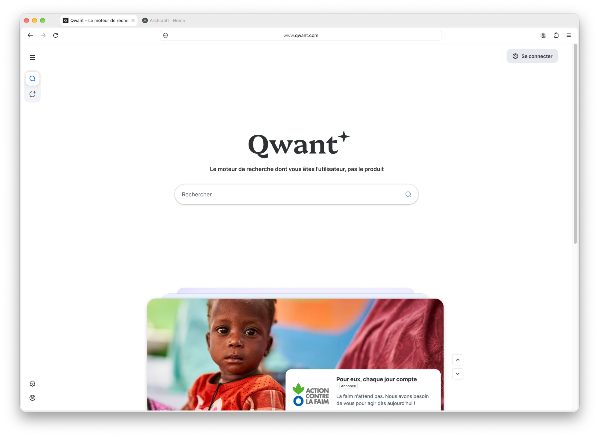
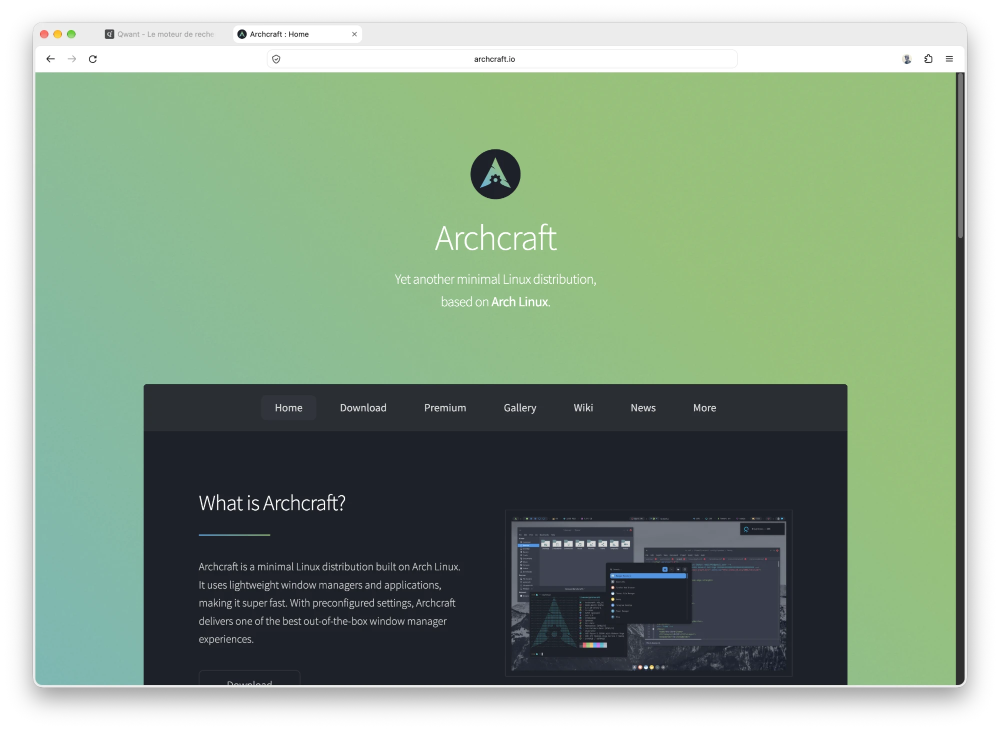
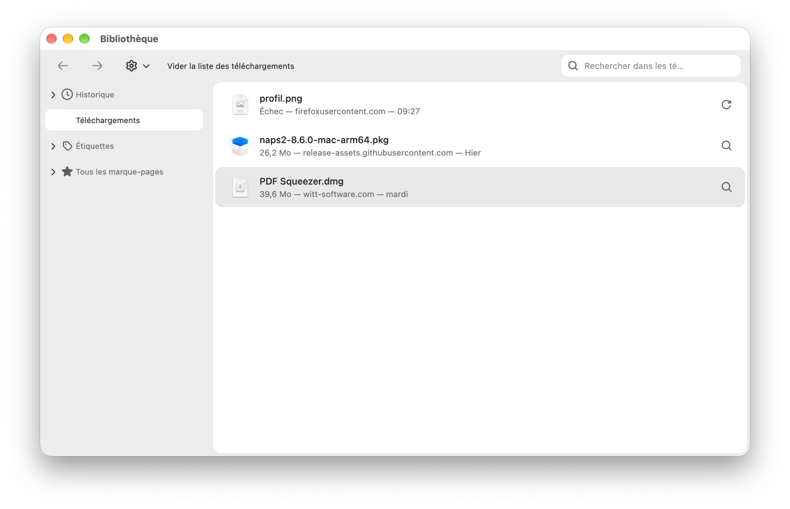
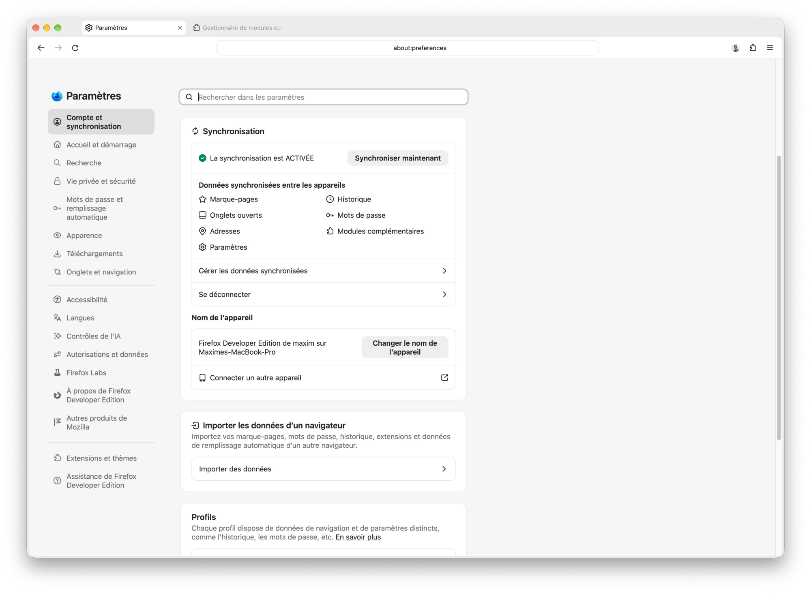
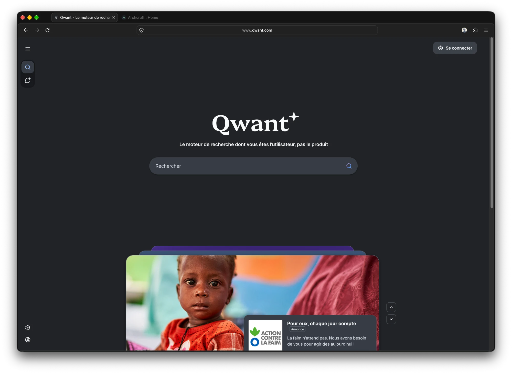
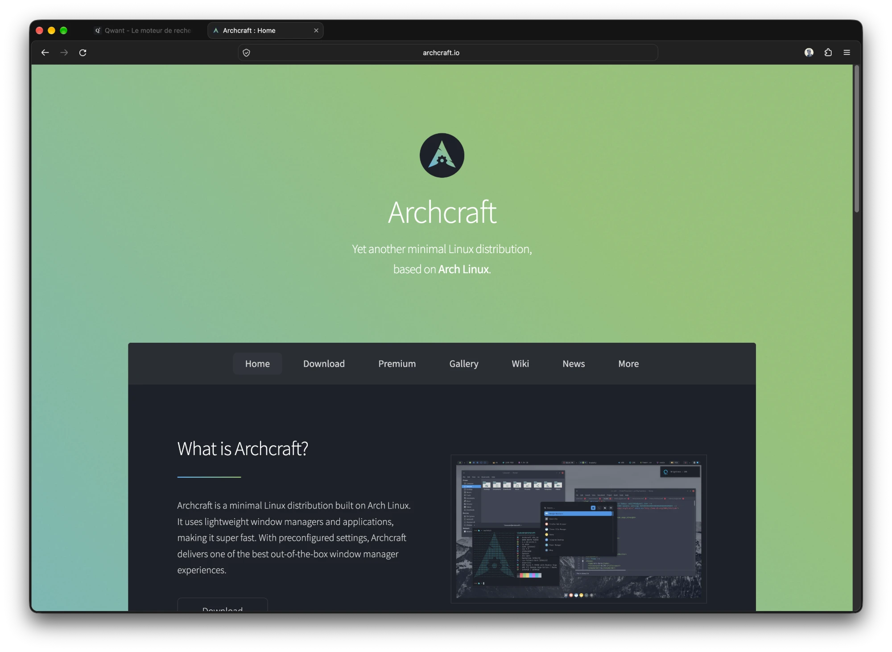
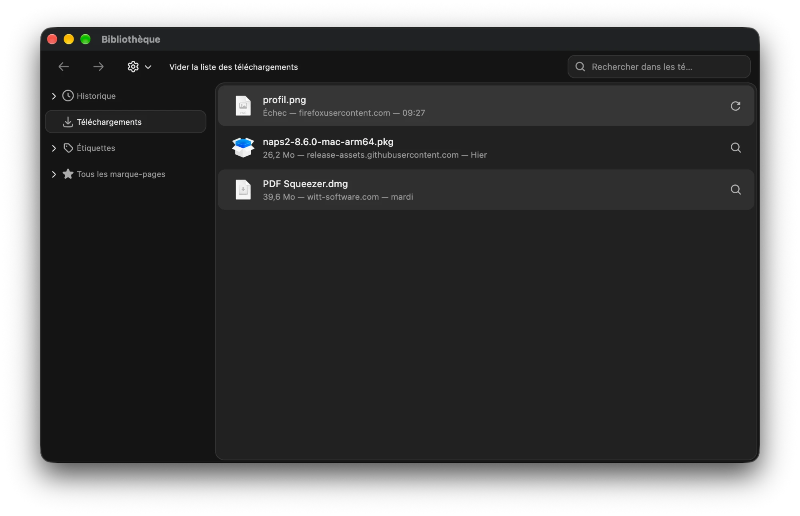
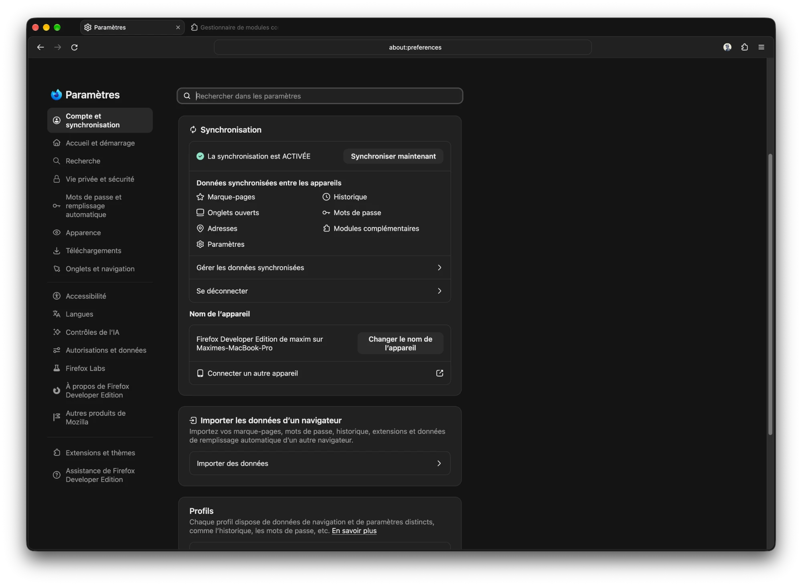

# Firefox userChrome

A simple light and dark theme for Firefox, made of two stylesheets:

- **`userChrome.css`** for the browser UI: tabs, address bar, menus,
  downloads panel, Library window. This is the theme itself.
- **`userContent.css`** (optional) for Firefox internal pages: settings,
  new tab, add-ons, `about:config`… It has no effect on websites.

What the theme does:

- Neutral background, pill-shaped tabs, centred address bar
- Toolbar and page merged into a single rounded card
- No purple: black, white and grey accents
- Switches automatically between light and dark with macOS
- Matching Library window, downloads panel and settings

## Screenshots

### Light

### Dark

## Installation

1. **Enable custom stylesheets.** Open `about:config` and set
   `toolkit.legacyUserProfileCustomizations.stylesheets` to `true`.
2. **Find your profile folder.** Open `about:support` and click
   **Profile Folder → Open Folder**. Create a `chrome` folder there if it
   does not exist.
3. **Copy the files** into that `chrome` folder:
   - `userChrome.css` for the browser UI theme;
   - `userContent.css` if you also want matching Firefox internal pages
     (without it, they keep Firefox's default colours, purple included).
4. **Set the theme to System.** In `about:addons` → **Themes**, enable
   **"System — auto"**. This is what lets the theme follow the macOS light
   or dark mode automatically.
5. **Restart Firefox.**

To make internal pages (and websites that support it) follow the macOS mode
as well: **Settings → General → Website appearance → Automatic**.

## Customisation

Colours, radius and spacing are set with the variables at the top of each
file (`--cx-bg`, `--cx-surface`, `--cx-radius`, `--cx-gap`…).
Both files share the same palette: remember to update both.

## Compatibility

Only tested on **macOS 27.2.1** with **Firefox Developer Edition 161.0**.

Rendering on Windows and Linux has not been checked. The theme relies on
Firefox internal names, which may change from one version to the next.
